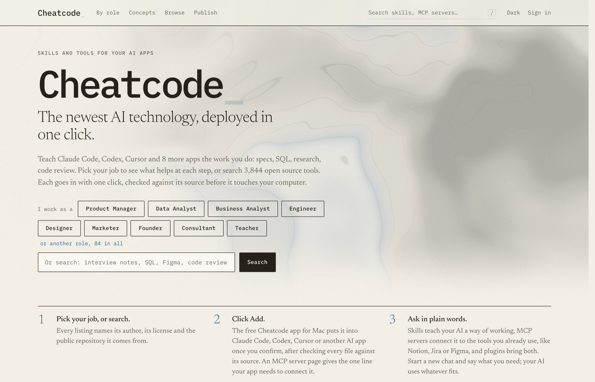
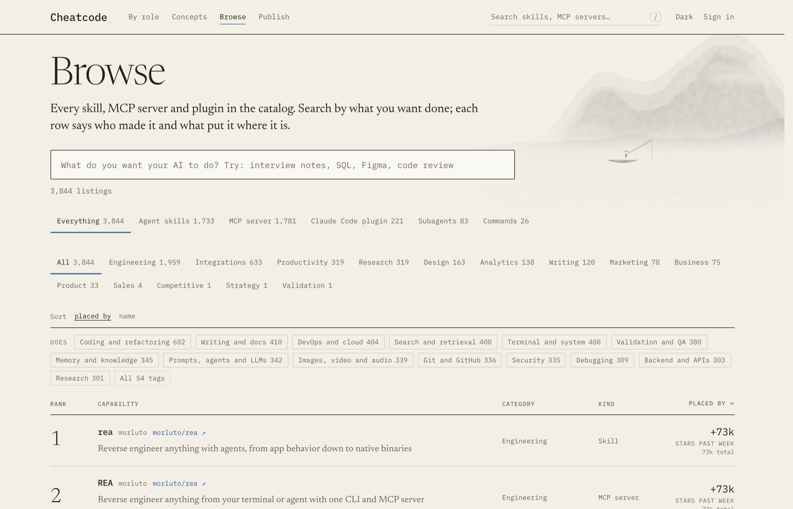
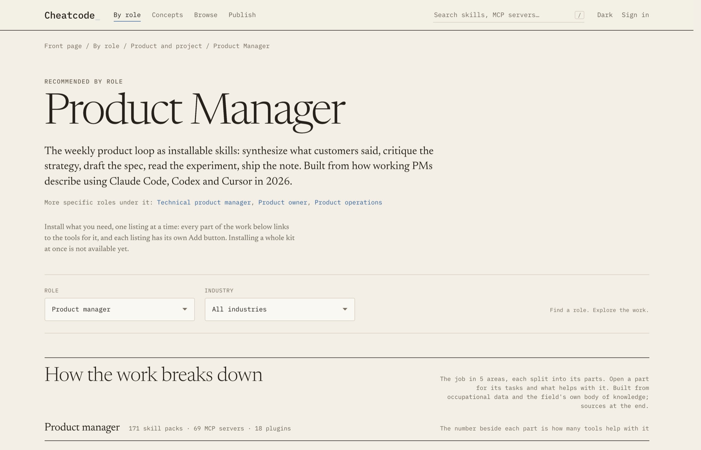
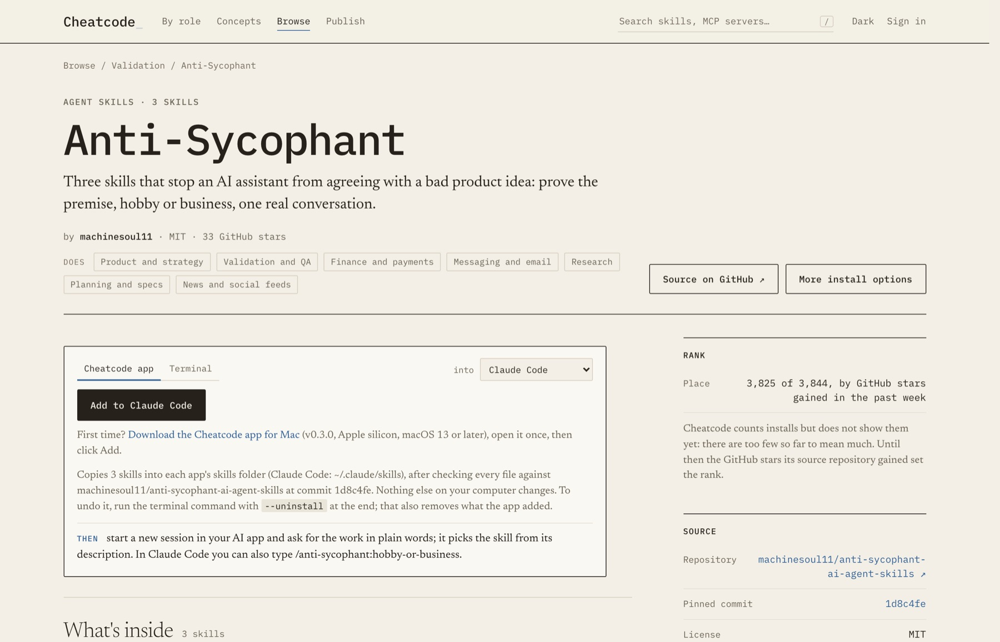
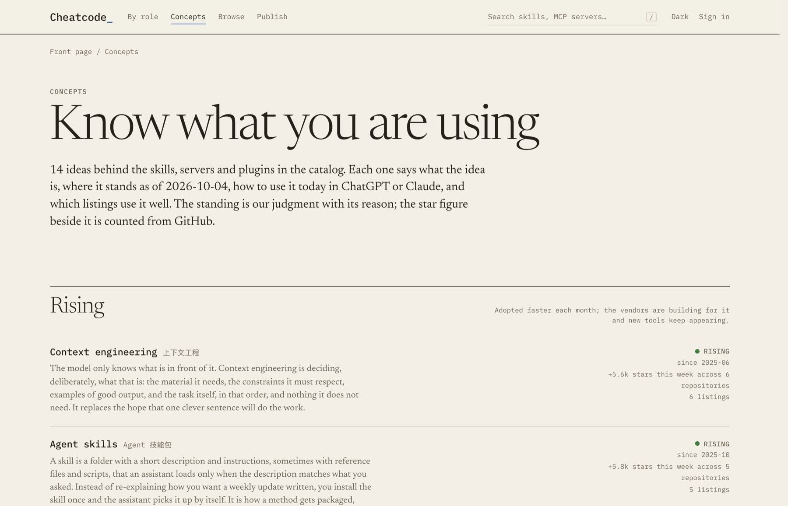
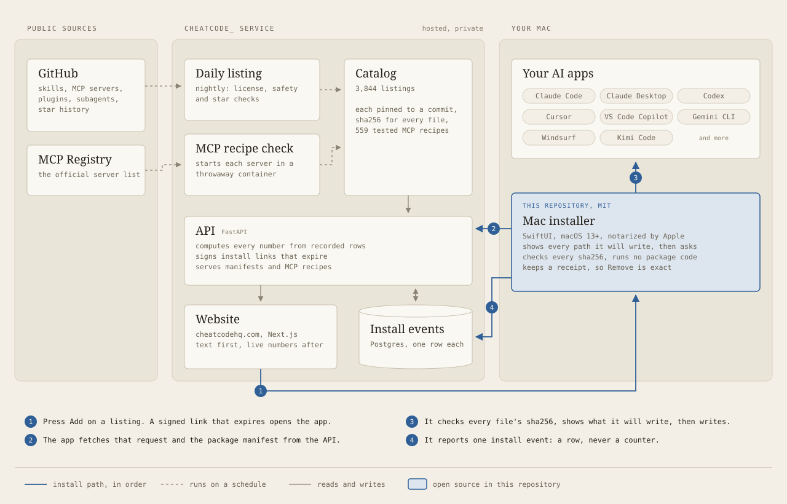

# Cheatcode_

**Skills and tools for your AI apps, added in one click.** Live at [cheatcodehq.com](https://cheatcodehq.com).

People who are not developers (product managers, analysts, students, teachers) hear that Claude Code, Codex or Cursor
can be taught new skills and connected to their tools, then hit a wall: a GitHub repository, a terminal command, a
JSON config file. Cheatcode_ is the layer in between. It indexes the open source skills, MCP servers and plugins people
publish, explains what each one is for in plain words, organizes them by the work they help with, and installs any of
them into the user's AI app with one button, after checking every file against its source.

This repository holds the parts of Cheatcode_ that are open source: the Mac installer, the package format, and three
skill packs. The website, API, catalog and ranking run as a hosted service and are not published here.

## What it does

| | |
|---|---|
| **3,844 listings** | Agent Skills repositories, MCP servers, Claude Code plugins, subagents and commands, each pinned to a commit and indexed as of 10 Oct 2026. New repositories are found and checked every night. |
| **11 AI apps** | Claude Code, Codex, Cursor, VS Code Copilot, Gemini CLI, Kimi Code, Trae, Doubao and more. Where each app keeps its skills and MCP servers is one table in the API. |
| **One click** | The Mac app adds a skill pack or an MCP server to the chosen app after the user reviews what it will write. Nobody opens a terminal or edits a config file. |
| **559 MCP servers verified** | Each was started in a throwaway container with no credentials and asked for its tools over MCP before its install recipe was published. |
| **84 roles, 47 jobs** | Every role is mapped to the work it does, researched from O*NET, the UK DDaT framework and professional bodies of knowledge, and every listing is placed on that map. |

| Browse | A role's work |
|---|---|
|  |  |
| **A listing, with the Add button** | **Concepts** |
|  |  |

## How it fits together

<picture>
  <source media="(prefers-color-scheme: dark)" srcset="docs/images/architecture-dark.svg">
  
</picture>

## Decisions worth explaining

- **Every number is computed, none is stored.** Rank and usage come only from install events and public GitHub star
  history. There is no editable counter anywhere, and placement is never paid. Until install volume means something,
  rows are placed by the GitHub stars their source gained in the past week, and the page says so.
- **Pinned and verified, never trusted.** A listing records a commit and the sha256 of every file. The installer
  refuses anything that does not match, never runs package content, and keeps a receipt of every path it wrote so
  removal is exact.
- **An MCP server is tested before it gets a button.** Recipes may only run `npx -y <package@version>` or
  `uvx --from <package==version>`, checked in the API and again in the app, because any other form can change what
  runs. Runtimes (Node, uv) are downloaded once at a pinned version and checked against their published hash.
- **Content first, data after.** Every page ships its text and the first rows of any list in the HTML; live numbers
  replace them in the browser with a deadline and a retry. A slow network sees the page, never a spinner.
- **Rules and words are written down and tested.** A rule library and a taxonomy sit beside the code, and the test
  suite fails when they drift apart. The product rules are published in [docs/RULES.md](docs/RULES.md).

## In this repository

| Folder | What | License |
|---|---|---|
| [installer/](installer) | The Mac app (SwiftUI, macOS 13+) behind every Add button: skill packs and MCP servers, review screen, receipts, Remove. Notarized releases are served from cheatcodehq.com. | MIT |
| [spec/](spec) | The package format: the Agent Plugins layout, the `cheatcode.json` manifest, how each AI app receives a package, and the checklist every indexed repository passes. | MIT |
| [packages/](packages) | Three skill packs written for Cheatcode_: requirements-kit (business requirements, acceptance criteria, UAT plans, traceability), pm-comms-kit (release notes in the house voice, replies to comments) and regulated-spec-sections (healthcare and fintech spec sections). | MIT |

PersonaLens, the strategy simulation skill on Cheatcode_, is a separate product and is not published here.

## Stack

FastAPI, SQLAlchemy and Alembic on Postgres; Next.js 14 with static rendering and incremental revalidation; SwiftUI
for the Mac app, notarized by Apple; Docker with zero downtime rollouts behind Caddy on a single VPS; GitHub's star
history API and the official MCP Registry as sources.

## Contact

Built by [Charles Ji](https://github.com/ChenxingJi-Innovate). Questions, publishing requests and security reports:
admin@cheatcodehq.com (see [SECURITY.md](SECURITY.md)).
